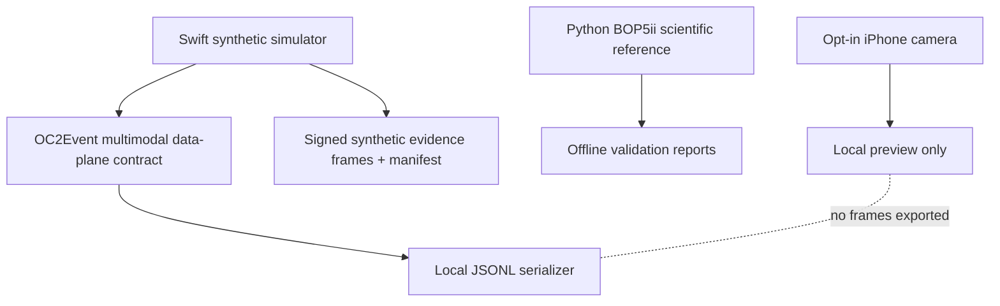

# OC2 architecture v2.0.0

## Boundaries
- **Simulation:** seeded RNG, multi-object bearings, auditory direction, SNR, occlusion, attention/arousal, SwiftUI visualization.
- **Research:** Python v1.0.0 classification and predictive statistical validation are retained, *not* ported or claimed equivalent to Swift.
- **Live:** AVFoundation camera permission, start/stop, local video preview; no raw frame persistence, recognition, audio, GPS, biometric inference, or remote streaming.
- **Handoff:** `OC2Event` JSONL schema version `oc2.event.v2`, fields include event ID, timestamp, source, kind, optional bearing/confidence, detail, synthetic flag. Current producer is synthetic only. Camera status remains local UI state.
- **Evidence:** Ed25519 signed frames + SHA-256 manifest; self-signed ephemeral identity. Verification must use an independently trusted public key to make identity claims.

## Merge provenance
- BOP5ii 1.0.0: `research-python/` source, tests, model and validation.
- OCCULUS 1.2.0: preserved offline synthetic dashboard.
- OCCULUS 1.3.0: native Swift core, iOS dashboard and evidence code.
- OC2 2.0.0: data plane schema, opt-in live camera preview, merged docs and CI.

## Planned work, not implemented
Live audio localization, camera-based recognition, cross-modal real sensor fusion, streaming broker, persistent secure signing keys, and real-device validation. Each requires explicit permissions, privacy controls, independent calibration and acceptance tests.

## v2.0.1 UML / architectural documentation

See [`uml/README.md`](uml/README.md), [`uml/01-domain-object-model.puml`](uml/01-domain-object-model.puml), [`uml/02-software-architecture.svg`](uml/02-software-architecture.svg), [`uml/03-runtime-sequence.puml`](uml/03-runtime-sequence.puml), and [`ADR-0006-BOOCH-UML.md`](ADR-0006-BOOCH-UML.md). The live preview is isolated from the data plane.
