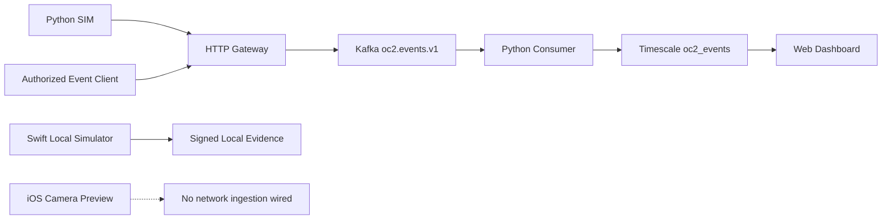

# Data Lineage, Quality, and Provenance

## Quality dimensions
Completeness: mandatory fields; validity: UUID, enum, timezone, finite confidence; uniqueness: event identity; consistency: mode and source provenance; timeliness: event vs ingestion lag; accuracy: synthetic ground-truth comparison; traceability: schema/model/producer version.

## Quality controls and gaps
Gateway validates top-level envelope but not detailed payload shape. Database has indexes for source/time and type/time. There is no automatic anomaly quarantine or dead-letter topic. Kafka auto-topic creation and plaintext transport are development-only. Define per-event idempotence and temporal quality checks before production.

## Retention and governance
Kafka retention defaults are not product-specific; Timescale retention policy absent; no object-storage evidence lifecycle configured. Retention schedule, legal hold, data minimization, access policy, and deletion process require explicit ownership.
